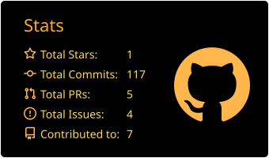
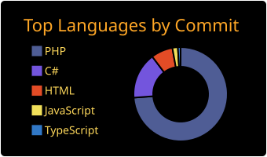

**Founder & CEO | Avalon Hosting Services | Avalon Incorporation | Avalon Global Solutions LLC**

 

 

 

---

## 👋 About Me

I'm **Engr. Arif Ahmed Joy**, a computer engineer (BEng, CSE, University of Asia Pacific) who turned a love for servers into a hosting company.

- 🏢 **Founder & CEO** of three companies:
  - [**Avalon Hosting Services**](https://github.com/AvalonHostingServices), a hosting company headquartered in Sheridan, WY, serving the USA, UK and beyond under the promise of ***"World's Local Hosting"***
  - **Avalon Incorporation**
  - **Avalon Global Solutions LLC**
- 🛠️ **12+ years** in web hosting, server troubleshooting and email systems, from the terminal to the boardroom
- ⭐ Freelancer by passion and choice: **Top Rated** on Upwork with **359+ jobs** delivered, **243 client reviews**, and a long-term trusted partner for agencies and startups
- 🌍 Based in **Dhaka, Bangladesh** and working across time zones
- 🗣️ Bengali (native) · English (fluent) · Hindi (conversational)

> *I solve the root cause, not just the symptom. Uptime, security and inbox placement are not features, they are the baseline.*

---

## ⚡ What I Do

| | Focus | What it means in practice |
|---|---|---|
| 🖥️ | **Server Administration** | cPanel/WHM, Linux VPS and dedicated servers: setup, hardening, tuning, recovery |
| 📬 | **Email Deliverability** | SPF, DKIM, DMARC, rDNS/PTR, Gmail and Outlook reputation, inbox placement |
| 🌐 | **DNS & Domains** | Cloudflare, propagation fixes, nameserver setup, domain/email conflict resolution |
| 🚚 | **Zero-Downtime Migrations** | cPanel, AWS and VPS moves with data integrity and clean DNS cutovers |
| ☁️ | **Cloud & Containers** | AWS (EC2, S3, Lightsail), Docker, self-hosted PaaS with Coolify |
| 🔐 | **Security & Performance** | SSL, firewalls, malware cleanup, resource tuning |
| 🧾 | **Hosting Business Ops** | WHMCS automation, provisioning workflows, support and billing integrations |
| 💻 | **Full-Stack Development** | Node.js, Express, NestJS, React and Next.js apps, plus PHP and Smarty customisation |

---

## 🧰 Tech Stack

**Control Panels & Hosting**

**Linux & Infrastructure**

**Cloud, DNS & Delivery**

**Web & Data**

**Frameworks, Runtime & Scripting**

---

## 🏡 Self-Hosted & Open Source Stack

I'm a big believer in owning your infrastructure. Where a SaaS bill can be replaced by a solid open-source tool, I self-host it.

| Need | Self-hosted choice | Replaces |
|---|---|---|
| 🚀 App deployment / PaaS | **Coolify** | Heroku, Vercel (paid tiers) |
| 🐞 Error & performance tracking | **GlitchTip** | Sentry |
| 📝 Headless CMS | **Strapi** | Contentful |
| 📧 Newsletters | **Sendy + Amazon SES** | Mailchimp |
| 🔁 Containerised everything | **Docker** | Manual installs |

---

## 🏆 Highlights

---

## 🤝 Let's Work Together

Facing **server errors, DNS problems, email deliverability issues or a migration**? Or looking for reliable hosting with real humans behind it?

- 🌐 Hosting: [avalonhosting.services](https://avalonhosting.services)
- 💼 Freelance: [Upwork profile](https://www.upwork.com/freelancers/~0198dfeb9fafd0e3fe)
- 🐦 Say hi: [@arifahmedjoy](https://twitter.com/arifahmedjoy)

*Built with ☕, uptime and a lot of DNS records.*

